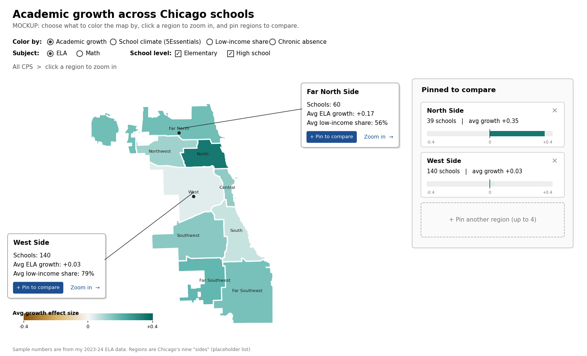

# Kaed Esposo

## Description

My static project asked what is related to academic growth in Chicago public
schools and found that school poverty sorts schools better than ISBE designation
or location. That project could only show one fixed comparison at a time. For
the interactive project I want readers to ask their own questions.

The centerpiece is an interactive map of Chicago. It starts at the biggest
level: all of CPS, broken into regions of the city (for example North, Northwest,
Central, and Far South; the final list is still to be decided). The map starts
out plain white, and the reader chooses what to shade it by: academic growth
(ELA or mathematics), the 5Essentials climate score, low-income share, chronic
absence, or other measures. From there a reader can drill down from a region to
its community areas and, if time allows, to individual schools. Readers can also
pin several groups, for example one region and one network, and keep them open in
a side panel to compare them directly.

The goal is to let people test the comparisons the static project could only
describe, and to see how much of the variation sits between groups versus inside
them. The page will show how many schools sit behind every number, since small
groups give noisy averages, and it will make clear that the patterns are
associations and not causes.

I know this is a big plan, and I expect to cut and simplify as I build. The
technical plan below lists what is core and what is a stretch.

## Technical Plan re: Option A/B/C/D

**Option A (Large Interactive).** The map is the centerpiece and takes up most
of the page, with explanatory text and the comparison panel around it. The
interactivity goes beyond hover and zoom: readers choose what the map is shaded
by, drill down through levels, filter by subject and school level, and build a
set of pinned groups to compare.

I chose Option A over Option C because the map is a choropleth of regions and
community areas, which D3 can draw directly from GeoJSON without street-level
base maps. That keeps the whole project in one library.

**Libraries**
- D3.js (v7) for the map (d3-geo), the comparison charts, color scales, and
  transitions.
- Python (pandas, geopandas) to clean the data, merge community areas into
  regions, and export school-level and group-level files as CSV/GeoJSON. The
  cleaning code will live in its own folder, separate from the website.
- Plain HTML and CSS for the page, with a standalone CSS file and standalone JS
  files.

**Interactions**
1. **Shade by:** a selector that picks what colors the map. The map starts white
   until the reader chooses a measure.
2. **Drill down:** click a region to see its community areas, and click a
   community area to see its schools.
3. **Pinned comparison:** pin up to four groups and compare them side by side in
   a panel (average of the chosen measure, number of schools, and the spread of
   schools). Groups can be geographic (regions, community areas) or school-based
   (a CPS network, elementary vs. high school).
4. **Filters:** subject (ELA or mathematics) and school level (elementary or high
   school).
5. **Small-group warning:** groups with very few schools are flagged or grayed
   out.

**Scope**

Core (must have):
- Region-level map that starts white, with a shade-by selector for growth and
  at least one other measure (low-income share or 5Essentials)
- Click a region to drill into its community areas
- Pinned comparison of at least two groups, with school counts

Stretch (cut if time runs short):
- Drill down to individual schools
- Grouping by CPS network and by elementary vs. high school
- Additional shading measures (chronic absence, enrollment change, ISBE
  designation)
- The second school year and other student groups
- Transitions and animation between levels

If time is short, I will drop the school level and keep region to community area.

**Inspiration**
- *270toWin simulation map* (https://www.270towin.com/2024-simulation/): the
  user clicks regions on a map to build a scenario and sees the result update. I
  want the same click-to-build behavior, applied to choosing and comparing
  groups of schools.
- *Google Public Data Explorer* (https://www.google.com/publicdata/explore):
  users select several entities and compare them over the same measure, and can
  change which measure is shown. This is the model for the pinned-group panel and
  the shade-by selector.

## Mockup

*(Image to be added: `milestones/interactive-mockup.png`.)*

Planned layout: a large map on the left, plain white at first, with a "Shade by"
selector and subject and school-level filters above it. A breadcrumb above the map
(All CPS > Region > Community area) shows the current drill-down level. A
legend updates when the shading changes. A comparison panel on the right holds the
pinned groups as stacked cards, each showing the group's name, the value of the
chosen measure, the school count, and a small strip of school dots. Clicking an
area on the map selects it, and a "Pin" button adds it to the panel. Below the map
is a short text explaining what the measures mean and how to read the page.

## Data Sources

### Data Source 1: CPS Academic Progress Indicator (student growth)

URL: https://www.cps.edu/about/district-data/metrics/

Size: 42,131 rows, 12 columns

School-level growth effect sizes for ELA and mathematics, split by student group
and by school year (2023-24 and 2024-25). This is the main outcome measure. In
the static project I used the "All Students" group for 2023-24, which gave
growth data for 596 schools. I may also use the other student groups and the
second year.

### Data Source 2: CPS school demographics (20th-day report)

URL: https://www.cps.edu/about/district-data/demographics/

Size: 998 rows, 13 columns (current-year file); 999 rows, 22 columns (2023 and
2024 enrollment files with grade-level counts)

One row per school, with network, governance (district, charter, and others),
community area, total enrollment, and the percentage of low-income students,
English learners, and students with IEPs. This supplies the grouping fields. I
will derive elementary vs. high school from the grade-level enrollment columns,
since the existing school type field only separates traditional, options,
specialty, and early childhood schools.

### Data Source 3: Chicago community area boundaries

URL: https://data.cityofchicago.org/Facilities-Geographic-Boundaries/Boundaries-City-Map/ewy2-6yfk

Size: 77 features (one per community area), with area number and name

GeoJSON polygons used to draw the map. I will add a lookup that assigns each
community area to a region and merge the polygons by region for the top-level
view, since regions are not part of this file.

### Additional shading measures (from the static project)

- **5Essentials climate scores** (UChicago Impact, https://reports.uchicagoimpact.org/):
  five survey scores per school for 2024 to 2026, about 645 rows per file. I
  averaged them into one climate score in the static project. I collected this
  data while the reporting site was publicly accessible.
- **Chronic absence rates** (Illinois State Board of Education, Illinois Report
  Card, https://www.isbe.net/pages/illinois-state-report-card-data.aspx): 60,129
  rows, 9 columns, school-level rates by year and student group.
- **ISBE school designations** (same source): 648 rows, 2 columns.

## Questions

1. The 2026 changes to this assignment are still pending. Does a D3 choropleth
   with drill-down, a shade-by selector, and pinned-group comparison still count
   as Option A, or will the requirements change?
2. I need to create two grouping fields that are not in my data: region (from a
   lookup of community areas) and elementary vs. high school (from grade-level
   enrollment). Is deriving these acceptable, and should I document the
   definitions on the page?
3. Does the pinned-group comparison panel count as non-trivial interactivity on
   its own, or should I also include something like a simulation or a
   user-built scenario?
4. Which hosting options will be available for the public site, and are there
   limits on the size of the data files?